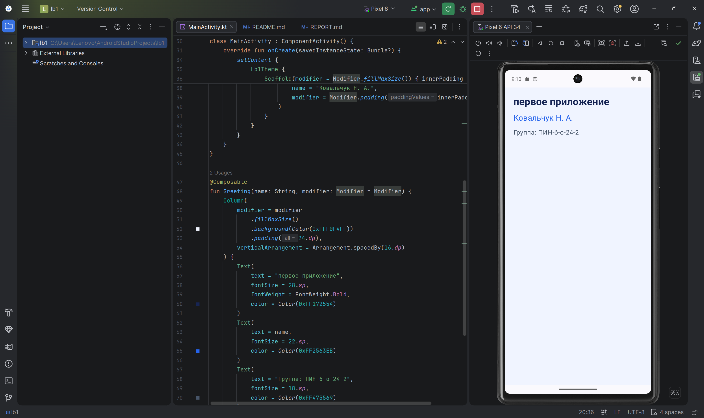

# Hello Compose — первое приложение на Jetpack Compose

## Описание проекта
Простое приложение для знакомства с Jetpack Compose — современным декларативным UI-фреймворком для Android.

## Скриншоты


## Технологии
- **Язык:** Kotlin
- **UI-фреймворк:** Jetpack Compose
- **IDE:** Android Studio
- **Минимальная версия Android:** API 24 (Android 7.0)

## Установка и запуск
1. Клонируйте репозиторий:
   ```bash
   git clone https://github.com/kirgoju/android-compose-hello.git
   ```
2. Откройте проект в Android Studio.
3. Дождитесь синхронизации Gradle.
4. Запустите эмулятор или подключите физическое устройство.
5. Нажмите кнопку Run (`Shift+F10`).

## Структура проекта
- `app/src/main/java/.../MainActivity.kt` — основной код приложения (весь UI на Compose).
- `app/src/main/java/.../ui/theme/` — тема приложения (цвета, типографика).
- `app/src/main/AndroidManifest.xml` — манифест приложения.

## Автор
**Ковальчук Никита Алексеевич** — студент группы ПИН-б-о-24-2, курс 3.

## Лицензия
MIT
