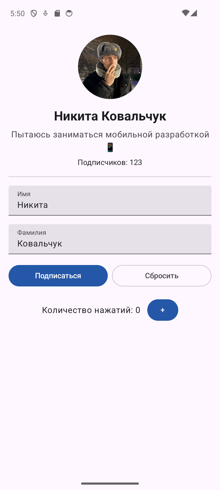

# Profile App — экран профиля на Jetpack Compose

Проект третьей лабораторной по программированию мобильных устройств.
На экране видны аватар, имя и фамилия, статус и число подписчиков.

## Что умеет приложение

- Показывает числовое количество подписчиков. «Подписаться» прибавляет одного подписчика, а «Отписаться» возвращает исходное число.
- Показывает изменения имени и фамилии сразу в заголовке профиля.
- Возвращает исходные имя и фамилию по кнопке «Сбросить».
- Увеличивает счётчик на единицу по кнопке «+».

## Запуск

Откройте в Android Studio папку с `settings.gradle.kts` и дождитесь
синхронизации Gradle. Выберите устройство или эмулятор и нажмите **Run**.
Используются Kotlin, Jetpack Compose и Material 3. Минимальная версия
для запуска приложения — Android 7.0 (API 24). Для сборки нужен Android
SDK Platform 37. На Windows Android Studio может использовать свой JDK для Gradle.

## Структура

Файлы Kotlin находятся в `app/src/main/java/com/example/profile`.

- `MainActivity.kt` запускает экран и применяет тему.
- `data/User.kt` хранит исходные данные профиля.
- `ui/ProfileScreen.kt` собирает экран и хранит его состояние.
- `ui/components/Avatar.kt`, `ProfileInfo.kt` и `ActionButtons.kt`
  отвечают за отдельные части интерфейса. У экрана и компонентов есть предпросмотры.

## Автор

Ковальчук Никита Алексеевич, группа ПИН-б-о-24-2, 3 курс.
